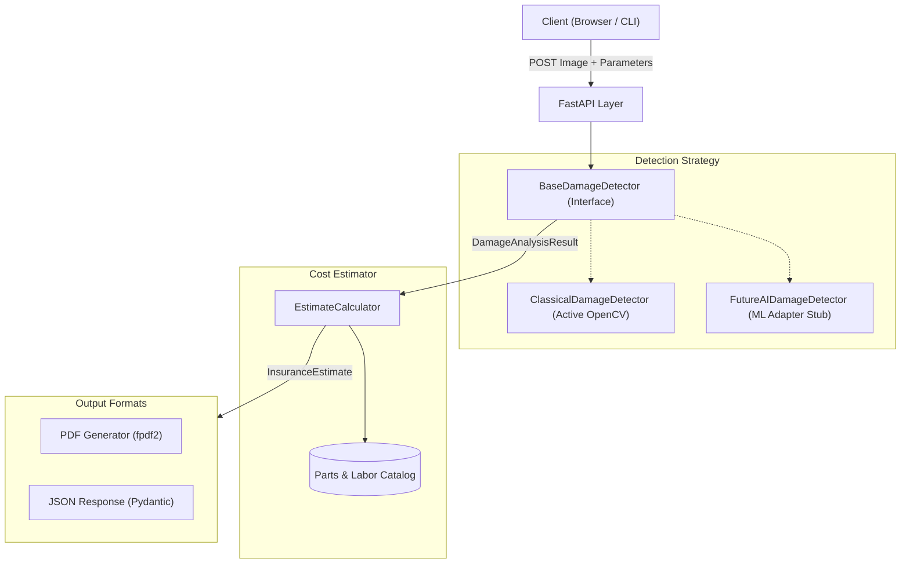

# Architecture and Engineering Trade-Offs

## System Design

AutoDamage CV follows the Strategy Pattern to decouple image processing from repair cost estimation. The system is split into three main layers:

1. **Detection Layer (`app/cv_engine`):** Takes raw image bytes, isolates damaged regions, and returns bounding boxes, defect types, and surface area in cm². It exposes a common interface (`BaseDamageDetector`) so alternative detection backends can be swapped in without modifying downstream code.
2. **Estimation Layer (`app/estimator`):** Consumes the detection results and applies industry repair guidelines (labor rates, paint refinishing standards, replacement thresholds) to produce an itemized invoice.
3. **Presentation Layer (`app/main.py`, `app/static`, `cli.py`):** Exposes the functionality through REST endpoints, a browser dashboard, and a command-line interface.

---

## Key Engineering Decisions

### 1. Classical Image Processing vs. Deep Learning

| Consideration | Classical Image Processing (Current) | Deep Learning (CNNs / YOLO) |
|---|---|---|
| **Determinism** | Fully deterministic. Running the same image with the same parameters always produces identical pixel coordinates. | Probabilistic. Small shifts in lighting or compression can change bounding boxes or confidence scores. |
| **Infrastructure** | Runs on standard low-power CPUs in under 90ms. No GPUs or cloud model APIs required. | Requires GPU instances for low-latency inference or introduces cold-start latency on serverless CPU. |
| **Dataset Needs** | None. Relies on standard signal-processing algorithms (Canny, Sobel, CLAHE). | Requires thousands of labeled car collision images across makes, models, and paint finishes. |
| **Generalization** | Effective for visible surface defects (scratches, dents, cracks), but sensitive to extreme dirt or reflections. | Handles complex backgrounds better once trained on a broad enough dataset. |

**Rationale:** For an initial version, classical CV offers fast, explainable results with zero hosting overhead. The `BaseDamageDetector` interface was designed specifically so a fine-tuned YOLO model can be added alongside or in place of the OpenCV pipeline when training data becomes available.

### 2. Monolith vs. Microservices

The application is bundled into a single FastAPI service that serves both the JSON API and the static web assets. 

For an MVP processing single-panel photos in under 100ms, splitting this into microservices would add unnecessary network hops, serialization overhead, and deployment complexity. If workload increases, the detection engine can be offloaded to an asynchronous worker queue (such as Celery with Redis) with minimal architectural changes.

### 3. Synchronous Execution

Because the OpenCV pipeline runs in under 90ms on standard CPUs, requests are handled synchronously in the HTTP request cycle rather than returning a job ID and polling. This keeps the client integration straightforward and eliminates the need for a separate database or cache for job status tracking.

---

## Complexity Analysis

- **Image Preprocessing & Edge Detection:** $O(N)$ where $N$ is total pixel count ($W \times H$). Large images are resized to a maximum dimension of 1280px to cap processing time.
- **Contour Finding:** $O(N)$ using the Suzuki-Abe border following algorithm (`cv2.findContours`).
- **Cost Calculation:** $O(K)$ where $K$ is the number of detected defect regions (typically under 20). Execution time is sub-millisecond.
